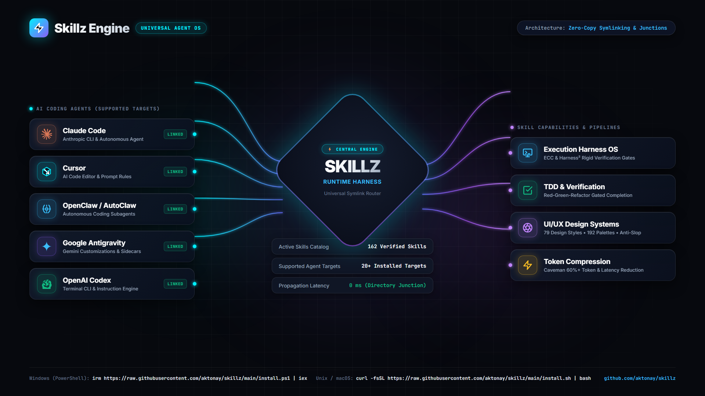

# ⚡ SKILLZ — Universal AI Agent Skills Engine & Runtime Harness

```
  ███████╗██╗  ██╗██╗██╗     ██╗     ███████╗
  ██╔════╝██║ ██╔╝██║██║     ██║     ╚══███╔╝
  ███████╗█████╔╝ ██║██║     ██║       ███╔╝ 
  ╚════██║██╔═██╗ ██║██║     ██║      ███╔╝  
  ███████║██║  ██╗██║███████╗███████╗███████╗
  ╚══════╝╚═╝  ╚═╝╚═╝╚══════╝╚══════╝╚══════╝
  ⚡ UNIVERSAL AGENT SKILLS & RUNTIME HARNESS ⚡
```

> **The universal skills engine, runtime harness, and one-command installer for Claude Code, Cursor, Google Antigravity, OpenAI Codex, Qwen, GLM, Windsurf, OpenHands, Cline, Roo, and all AI coding agents.**

Equips your AI coding agents with an autonomous execution harness, software engineering discipline, token optimization, enterprise design systems, and 162+ production engineering skills through a single unified engine.

<p align="center">
  
</p>

---

## 🚀 Instant 1-Command Universal Installation

Install and activate all **162 production skills** across every AI coding agent on your machine in a single command:

### 🪟 Windows (PowerShell)
```powershell
irm https://raw.githubusercontent.com/aktonay/skillz/main/install.ps1 | iex
```

### 🍎 Linux & macOS (Bash)
```bash
curl -fsSL https://raw.githubusercontent.com/aktonay/skillz/main/install.sh | bash
```

### 📦 Node / NPX
```bash
npx git+https://github.com/aktonay/skillz.git install --all --target all
```

### 🤖 For AI Coding Agents (Claude Code, Cursor, Antigravity, Codex, etc.)
Simply give your AI agent this prompt:
> *"Install the Skillz universal pack across all agents by running:*
> `skills install --all --target all`"

---

## 🧙 Interactive 6-Question Role Setup Wizard & Persona Profiles

Different engineering roles require different agent capabilities. **Designers don't need python test runners or cloud infrastructure bloat**, while **QA test engineers don't need 43 UI design systems or animation timelines**.

Skillz includes an **interactive 6-question profiling wizard** that tailors your agent's skills to your exact workflow in seconds:

```bash
skills wizard       # Runs the interactive 6-question setup questionnaire
skills profiles     # Displays all available role profiles and exclusions
```

### 📋 The 6 Profiling Questions

| # | Question Focus | What It Configures | Options |
|---|---|---|---|
| **1** | **Primary Role & Agent Archetype** | Determines core domain specialization and filters out irrelevant domain bloat. | `1` 🎨 **Designer**: 43 UI design systems, animations, styling *(skips QA & testing)*<br>`2` 🛡️ **QA Engineer**: Pytest, verification gates, TDD, debugging *(skips 43 UI designs)*<br>`3` ☁️ **Backend Architect**: GCP, Docker, APIs, reliability, architecture *(skips UI design)*<br>`4` 🧠 **AI Agent Orchestrator**: ECC Harness, Harness² OS, superpowers, caveman *(skips UI)*<br>`5` 🚀 **Full-Stack Founder**: Curated 12 top UI designs + TDD + backend + QA + cloud<br>`6` ⚡ **Universal Power User**: Complete 162-skill arsenal across all 11 categories |
| **2** | **Engineering Rigor & Verification** | Sets the strictness of testing and completion gating. | `1` 🔒 **Strict & Contract-Driven**: Mandatory TDD, halt-on-failure contracts<br>`2` 🔄 **Pragmatic & Agile**: Iterative plan-before-act, fast feedback loops<br>`3` ⚡ **Rapid & Creative**: Frictionless prototyping without test barriers |
| **3** | **Token Efficiency & Communication** | Configures agent verbosity and token compression. | `1` ⚡ **Caveman Token Compression**: Saves 60%+ tokens with ultra-terse execution<br>`2` 📖 **Standard & Conversational**: Full explanations, detailed reasoning notes |
| **4** | **Optional Feature Packs** | Allows adding cross-functional packs outside the primary role. | `1` Cloud & Infrastructure &bull; `2` Python & QA Automation &bull; `3` UI/UX & Design &bull; `4` Cursor Tools &bull; `5` Pure Role Focus |
| **5** | **Target AI Coding Agent(s)** | Selects which agents to install and link. | `1` All detected agents on PC &bull; `2` Claude Code &bull; `3` Cursor &bull; `4` Antigravity &bull; `5` OpenClaw &bull; `6` Windsurf |
| **6** | **Filesystem Link Strategy** | Selects live synchronization or static copies. | `1` 🔗 **Zero-Drift Symlink / Junction** (Edits in repo reflect immediately)<br>`2` 📁 **Standalone Directory Copy** (Isolated files) |

### 🎯 Role Profiles Breakdown (Clean Specialization)

| Profile ID | Target Role | Skills Included | Categories Excluded (No Bloat) | Example 1-Liner |
|---|---|:---:|---|---|
| `designer` | 🎨 **Frontend & UI/UX Designer** | **65** | 🐍 `python-testing`, ☁️ `cloud`, 🧠 `agent-harness`, 🧭 `ide-meta` | `skills install --profile designer` |
| `qa` | 🛡️ **QA & Reliability Engineer** | **32** | 🎨 `design` *(skips all 43 CSS & UI design libraries)* | `skills install --profile qa` |
| `backend` | ☁️ **Backend & Cloud Architect** | **49** | 🎨 `design` *(skips all 43 CSS & UI design libraries)* | `skills install --profile backend` |
| `agent-harness` | 🧠 **AI Agent Orchestrator** | **53** | 🎨 `design` *(skips all 43 CSS & UI design libraries)* | `skills install --profile agent-harness` |
| `fullstack` | 🚀 **Full-Stack Solo Founder** | **94** | Curated balance: top 12 UI designs + full TDD + cloud + QA | `skills install --profile fullstack` |
| `all` | ⚡ **Universal Power User** | **162** | None *(All 11 categories active)* | `skills install --profile all` |

---

## 🎯 What Skillz Does

Skillz upgrades autonomous coding agents from simple chat assistants into disciplined, high-velocity engineering partners. It provides:

### 1. 🛡️ Autonomous Agent Harness OS & Verification Loops
- **Rigid Sequential Engineering Pipeline**: Enforces a strict multi-step workflow (`Plan` ➔ `Test` ➔ `Implement` ➔ `Review` ➔ `Verify` ➔ `Remember`).
- **Gated Progress & Halt-on-Failure**: Forbids marking tasks complete without deterministic test passes. No hallucinated victories or false reports.
- **Recursive Agent Harnessing**: Dynamically adapts agent tools, verification probes, and context windows for complex open-world tasks.
- **Contract & Invariant Enforcement**: Locks task scopes so agents cannot make unauthorized modifications outside declared requirements.

### 2. ⚡ Token & Latency Compression Engine
- **60%+ Token Reduction**: Cuts verbose pleasantries, conversational filler, and redundant boilerplate from model generation loops.
- **Accelerated Turnaround**: Slashes round-trip response times and token costs while keeping code diffs, architectural decisions, and diagnostics razor-sharp.
- **Adaptive Terse Mode**: Dynamically compresses agent reasoning and memory logs during long-running tasks.

### 3. 🧪 Superpowers Engineering Methodology & TDD
- **Test-Driven Development (TDD) Invariants**: Forces agents to write failing unit/integration tests before writing implementation code.
- **Git Worktree Isolation**: Runs complex refactors, experiments, and subagents in throwaway git worktrees to keep your working branch clean.
- **Autonomous Subagent Audits**: Spawns isolated peer-review passes to audit code quality, edge cases, and security vulnerabilities prior to commits.
- **Bug Reproduction Gating**: Requires creating reproducible test cases before any bugfix is accepted.

### 4. 🎨 Enterprise UI/UX & High-Performance Design Systems
- **79 Curated Design Systems**: Bento grid, sleek SaaS dark modes, glassmorphism, neo-brutalism, minimal luxury, and accessible high-contrast themes.
- **192 Production Color Palettes & 74 Font Pairings**: Curated HSL tokens and Google Font pairings calibrated for enterprise aesthetics.
- **70+ Brand Design Specifications**: Production-ready styling guides modeled after Linear, Stripe, Apple, Vercel, and modern tech leaders.
- **Fluid Animation & Micro-Interactions**: GSAP timeline controllers, animated React components, interactive WebGL shader canvases, and 3D scroll scrubbers.
- **Anti-AI-Slop Visual Quality Gates**: Automated inspection checks that eliminate generic AI-generated interfaces, ensuring proper hierarchy, padding rhythms, contrast ratios, and interactive states.

### 5. ☁️ Cloud, Systems & Reliability
- **Production Cloud Patterns**: Google Cloud architecture, Cloud Run deployments, Docker multi-stage containers, Kubernetes manifests, and Terraform IaC.
- **Gravitas Invariant Checking**: Deterministic checks that validate contracts and verify mutations with real test evidence.
- **Continuous Registry Synchronization**: Validates frontmatter, licenses, and dependencies across all skills.

### 6. 🔄 Universal Cross-Agent Symlinking & Zero Disk Waste
- **Directory Junctions & Symlinks**: All 20+ agent environments link back to a single canonical source on your machine.
- **Instant Synchronization**: Modifying any skill in Skillz updates Claude Code, Cursor, Antigravity, and all other agents in real time without reinstallation.
- **Smart Deduplication & Skip Engine**: Checks existing links and automatically skips up-to-date skills while refreshing stale links to the latest revision.

---

## 🤖 Supported Agents Matrix (20+ Targets)

| Agent | Config Directory | Integration Protocol |
|---|---|---|
| **Claude Code** | `~/.claude/skills` | Standard `SKILL.md` frontmatter + CLI |
| **Cursor** | `~/.cursor/skills-cursor` | Agent tools, prompt rules & MDC rules |
| **Google Antigravity & Gemini CLI** | `~/.gemini/config/skills` | Native Customization System & Sidecars |
| **OpenAI Codex CLI** | `~/.codex/skills` | Instructions & Tool Schemas |
| **Qwen Agent** | `~/.qwen/skills` | Skill runners & execution loops |
| **GLM / ZCode / ZEncoder** | `~/.zcode/skills` | Standard agent tools & templates |
| **Windsurf (Codeium)** | `~/.codeium/windsurf/skills` | Cascade rules & prompt hooks |
| **OpenHands** | `~/.openhands/skills` | Tool wrappers & environment runners |
| **Cline** | `~/.cline/skills` | Custom instructions & skill definitions |
| **Roo Code** | `~/.roo/skills` | Mode instructions & custom skills |
| **Trae** | `~/.trae/skills` | Agent skill integration |
| **GitHub Copilot** | `~/.copilot/skills` | CLI extensions & agent rules |
| **Continue.dev** | `~/.continue/skills` | System prompts & custom tools |
| **Kiro / Adal / Pochi / OpenClaw** | Respective agent directories | Standard multi-agent skill layout |

---

## 📦 162 Production Skills Breakdown

| Category | Skills | What They Do |
|---|:---:|---|
| **Agent Harness OS** | 11 | Multi-stage execution pipelines, test gates, invariant checkers, recursive harnesses |
| **Superpowers** | 12 | Test-Driven Development, git worktrees, systematic debugging, subagent peer reviews |
| **Token Efficiency** | 8 | Terse mode, token compression, prompt optimization, latency reduction |
| **UI/UX & Design** | 43 | Design tokens, color palettes, motion choreography, bento grids, anti-AI-slop gates |
| **Development & Review** | 18 | Code review, performance auditing, security scanning, refactoring workflows |
| **Google Cloud & Infra** | 13 | Cloud Run, Kubernetes, Terraform modules, Docker deployment setups |
| **Cursor Tools** | 21 | Rule generators, context builders, multi-file editors, scratchpad workflows |
| **Reliability Engines** | 5 | Gravitas contract verification, Snapdec evaluation and scoring |
| **Python Testing** | 9 | Pytest runners, coverage gates, pre-commit fixtures, linting suites |
| **Engineering Stacks** | 2 | Full-stack engineering workflows and dependency graph analyzers |
| **IDE Customization** | 3 | Editor extension guides, sidecar configs, custom tool setups |

*For the complete catalog of individual skills, see [CATALOG.md](CATALOG.md).*

---

## 🛠️ CLI Command Reference

The global `skills` and `skillz` commands manage your entire skill catalog:

```bash
# Interactive 6-Question Setup Wizard
skills wizard

# View all Persona Profiles and Category Exclusions
skills profiles

# Install by Persona Profile (Skips irrelevant domain bloat)
skills install --profile designer --target all   # 65 UI design & animation skills (skips QA & testing)
skills install --profile qa --target all         # 32 QA & pytest skills (skips 43 UI designs)
skills install --profile backend --target all    # 49 cloud & systems skills (skips 43 UI designs)
skills install --profile fullstack --target all  # 94 curated founder essentials

# Universal 1-Click Installation (Installs all 162 skills across all categories)
skills install --all --target all

# Update and re-sync all latest skills
skills update

# Install a specific skill to a specific agent
skills install ecc --target claude
skills install ui-ux-pro-max --target cursor

# Install all skills in a category
skills install --category design --target all

# Show installation status and linked agents on your PC
skills status

# Search across all 162 skills by keyword
skills search "animation"

# View complete metadata, instructions, and preview of a skill
skills info harness2

# Lint and validate all SKILL.md files
skills validate

# Rebuild machine-readable registry and catalog
skills sync

# Scaffold a new custom skill
skills new my-custom-skill agent-harness

# Open a skill in your editor
skills edit caveman

# Launch the interactive local visual dashboard
skills ui
```

---

## ⚙️ How It Works Under the Hood

### 1. Smart Deduplication & Skip Logic
When you run `skills install`, Skillz inspects the destination path:
- If a skill is already linked to the latest canonical source, it outputs `⏩ Skipped (already latest)` and moves to the next item instantly.
- If a link points to a stale revision or an old copy, it replaces it with the latest canonical junction.
- If multiple skills or agents share paths (such as Gemini & Antigravity), target paths are automatically deduplicated.

### 2. Standard YAML Frontmatter
Every skill follows the universal agent standard in its `SKILL.md`:
```yaml
---
name: skill-name
description: Concise summary of what this skill does and when to activate it
license: MIT
---
```
Agents natively parse this frontmatter to auto-discover when to invoke the skill.

---

## 📄 License
MIT License. Free for developers, teams, and autonomous AI agents.
